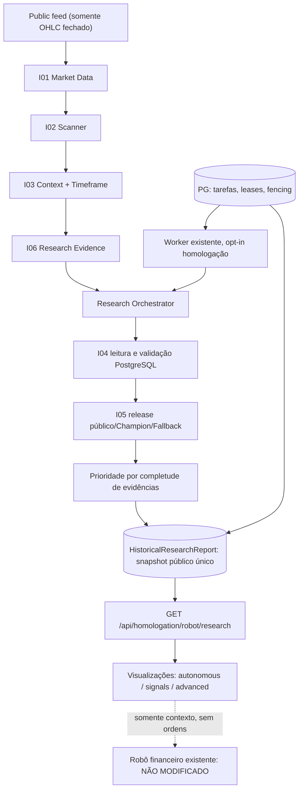

# NEXORA INTELLIGENCE 2.0 — primeira versão funcional de homologação

**Base de implementação:** PR #64 (`feature/intelligence20-stage2-distributed-research`) e, por dependência, PRs #59–#63. Todas preservadas em DRAFT, sem merge ou deploy.

**Referência de decisões:** `NEXORA_Intelligence_2_0_Etapa_2_Relatorio.pdf` (4 páginas), fornecido pelo responsável do projeto. Em particular:
- Página 2: I01 → I02 → I03 → I06 → Research Orchestrator, I04/I05 persistidos; zero execução financeira.
- Página 3: 583 testes gerais, 23 do ciclo I05 e 10 da coordenação PostgreSQL no SHA da PR #64; a carga de 500 **leituras simuladas com 16 threads** não comprova 500 usuários simultâneos.
- Página 4: homologação multi-instância, cache distribuído, limites de feed e migrações em produção permanecem pendentes.

O PDF referencia o SHA da **Etapa 2** `4d54b4cb4f16d30cc917ccb51c67085372407b94`; não é evidência dos testes desta PR. Estes são reportados separadamente pelo CI do SHA de homologação.

## O software entregue (executável, não só plano)

**Nenhum scanner, API financeira ou Knowledge Base duplicado.**

### Componentes de software

- **`homologation_runtime.run_homologation_cycle`**: operação explícita de homologação, bloqueada fora do estágio `homologation`, utiliza `enqueue_public_task` + `run_one_public_research_task` existentes e seus mecanismos transacionais PostgreSQL. Executa a cadeia pública I01–I06, a pesquisa I04/I05, priorização e persistência **atômica sob fencing**. Não cria tarefas ao importar o módulo e não inicia automaticamente no servidor.
- **`load_shared_public_snapshot`**: consulta apenas o relatório público interno persistido em `HistoricalResearchReport`; não reexecuta o feed por usuário, não acessa a tabela de contas, não utiliza dados financeiros. Exige digest da chave, versão, tempo de observação e vigência de cada item; recusa payloads adulterados e descarta dados vencidos. Usa a tabela e o cache já existentes.
- **`robot_research_view`**: DTO mínimo e compartilhado por todas as visualizações. Mostra estado de revisão (`RESEARCH_READY`, `WAIT_RECHECK`, `EXCLUDED`), completude das evidências, validade, justificativas e versões da Knowledge Base/Learning. **Não apresenta CALL/PUT, preço de entrada, expiração contratual, stake, autorização, ordens ou recomendação**.
- **`GET /api/homologation/robot/research?view=autonomous|signals|advanced`**: usa a autenticação existente e um snapshot global idêntico para todos os usuários. É exclusivamente uma **interface de leitura** para demonstração em homologação, sem alterar a lógica real dos três modos e sem novos controles de início/compra.

### Gates para a homologação isolada

A leitura e o ciclo público só existem se **todas** as condições forem verdadeiras:
- `NEXORA_DEPLOYMENT_STAGE=homologation`;
- `NEXORA_INTELLIGENCE_HOMOLOGATION_READONLY_ENABLED=true`;
- `NEXORA_INTELLIGENCE_DISTRIBUTED_RESEARCH_ENABLED=true`;
- `NEXORA_REAL_AUTOPILOT_ENABLED` e `NEXORA_REAL_RELEASE_APPROVED` diferentes de `true`.

As flags são **OFF por padrão** e não foram alteradas em produção. A migração formal da PR #64 é exigida para a fila e os snapshots PostgreSQL, mas **nenhuma migração foi aplicada fora do PostgreSQL descartável do CI**.

### Estados observáveis

- `NO_SHARED_RESEARCH`: nenhuma avaliação pública persistida.
- `CURRENT_PUBLIC_RESEARCH`: snapshot recente com dados públicos de pesquisa ainda válidos.
- `NO_CURRENT_PUBLIC_ITEMS`: snapshot íntegro, mas nenhuma evidência aproveitável no momento.
- `SNAPSHOT_EXPIRED`, `SNAPSHOT_UNTRUSTED`, `SNAPSHOT_DIGEST_MISMATCH` ou `SNAPSHOT_DUPLICATED`: falha fechada, sem exposição de informações antigas ou inconsistentes.
- HTTP 401: sessão não autenticada; HTTP 503: homologação não habilitada ou banco indisponível; HTTP 422: visualização inválida.

**A completude de evidências não representa probabilidade de ganho, confiança financeira ou capacidade preditiva homologada.**

## Testes funcionais executáveis

- `python -m pytest -q tests/test_intelligence20_homologation_runtime.py`: autenticação, três visualizações, privacidade, validade, zero ativação de execução e bloqueio fora de homologação. **São testes unitários/de contrato sem PostgreSQL.**
- `python -m pytest -q -s tests/test_intelligence20_public_coordination_pg.py`, usando **exclusivamente** o `postgres-public-research` descartável definido no GitHub Actions: migrações F01 → I04 → coordenação e testes existentes de concorrência, mais **fluxo completo real I01/I02/I03/I06 + I04/I05 + worker persistente + GET autenticado**, com os únicos doubles sendo os retornos do **feed público de candles e catálogo**. A conexão PG, a fila, os algoritmos, as consultas de conhecimento/modelos e a rota são os códigos reais. Não há ordens ou acesso às contas do robô.
- A suíte geral existente continua executando todos os testes do projeto.

**O que está comprovado:** pipeline público executado de ponta a ponta sobre candles determinísticos, persistência PostgreSQL e mesma leitura HTTP para todas as visualizações, sem duplicar scanners por usuário.

**O que não está comprovado:** feed externo Deriv em produção, 500 usuários simultâneos, integração operacional financeira do robô, cache em múltiplas instâncias, recuperação multi-Render, desempenho com rede real ou homologação de compliance. Estes permanecem futuros, e não serão declarados concluídos sem os testes específicos.

**Restrições:** PR DRAFT, nenhuma alteração na `main`, sem merge/deploy/migração em produção, nenhuma ativação REAL e nenhuma operação financeira.
