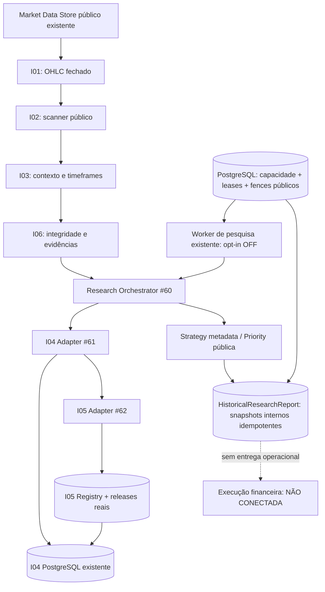

# NEXORA INTELLIGENCE 2.0 — Etapa 2: pesquisa pública distribuída

**PR:** #64, DRAFT, baseada na PR #63. Sem merge, deploy, migração
de produção, habilitação de Intelligence ou alteração da execução REAL.

## Arquitetura incrementada

O I01 reaproveita `market.shared_candle_request`, com cache em
processo, inflight dedup e `shared_market_store.py` já existente,
opcional e persistido em PostgreSQL. Nenhum novo feed Deriv, segundo
cache OHLC, scanner, token individual ou API de compra foi criado.

## 1. Ciclo real de modelos I05

`tests/test_intelligence20_real_i05_lifecycle.py` reutiliza os
mecanismos e testes de persistência da PR #56, adaptando unicamente
a preparação de metadados I04 separados em banco descartável.
Exercita:

- Challenger gravado como `UNDER_VALIDATION` e sem Champion implícito;
- três grupos públicos independentes de treino/holdout/OOS,
  embargo temporal e validação por I05 real;
- promoção de **release de pesquisa** apenas com a flag explícita
  **nos testes descartáveis** e com todos os critérios I05;
- persistência do Champion e do Fallback da implementação real;
- proteção CAS contra promoção concorrente/obsoleta;
- monitoramento de duas janelas OOS distintas e rollback de release
  público por I05, sem alterar ordens ou estratégias financeiras;
- rejeição de modelos adulterados, vencidos e sujeitos a revisão;
- recuperação após reconstrução do pool SQLAlchemy, verificando que
  o histórico do modelo e a geração do release persistem.

Os métodos são os da I05 original (`stage_public_candidate`,
`append_independent_public_validation`,
`validate_research_challenger`,
`promote_research_champion`, `get_research_release`,
`monitor_and_rollback`), não releases inventados.
A flag de promoção nunca é alterada na configuração de produção.

## 2. Capacidade distribuída e coordenação

`app/intelligence2/public_research_coordinator.py` implementa **somente
coordenação de tarefas públicas de pesquisa**, sem usuários individuais
ou participação na capacidade financeira do robô:

- PostgreSQL como autoridade transacional, tabela singleton
  `public_research_capacity` serializada por `SELECT FOR UPDATE`;
- teto fixo de segurança de **8 workers públicos**, limite dinâmico
  explícito de 1 a 8; jamais ultrapassa o menor dos dois;
- política consultiva de redução/aumento baseada em p95 e taxa de
  erros, sem modificar o teto;
- orçamento de **até 60 claims de pesquisa/minuto**, independente de
  usuários; *não equivale a limitar todas as chamadas efetivas à Deriv*;
- `public_research_tasks`: chave idempotente e digest de proveniência,
  estados PENDING/RUNNING/DONE/FAILED, leases, fence crescente,
  retry com backoff, recuperação de tarefas expiradas;
- conclusão exige worker, fence e lease válidos; um lease antigo não
  pode registrar um resultado;
- heartbeat renova o lease de um trabalho longo enquanto ele
  progride. O commit de `HistoricalResearchReport` e a conclusão
  de tarefa ocorrem **na mesma transação e sob o mesmo fence**;
- métricas do worker (teto, capacidade dinâmica, leases ativos,
  estados, erros, budget e p95) por consulta ao PostgreSQL,
  sem IDs de usuários, saldos ou informações de contas.

Metadados SQLAlchemy de coordenação ficam fora de `db.Base`.
As tabelas só existem após a migração **formal** da etapa 2,
preservando a startup sem DDL I04/I20.

A nova flag `NEXORA_INTELLIGENCE_DISTRIBUTED_RESEARCH_ENABLED`
é **OFF por padrão**. `research_persistence.research_loop()` reutiliza
o worker atual e somente consome tarefas enfileiradas quando a flag
estiver explicitamente true após aprovação futura. A aplicação
não publica endpoint novo para enqueue ou para execução.

## 3. Strategy Intelligence / Priority / Distribution

`app/intelligence2/public_research_decisions.py` oferece apenas
uma camada de **avaliações públicas não operacionais**:

- aceita os estados já existentes `RESEARCH_READY`,
  `WAIT_RECHECK` e `EXCLUDED`, verificando novamente validade,
  completude, conflito de contexto e proveniência;
- ordena avaliações para revisão humana por consistência e
  completude das evidências. O score não é um indicador de
  rentabilidade/probabilidade;
- suprime repetição do mesmo ativo e retira itens expirados;
- persiste snapshots internos com digest público na tabela
  `HistoricalResearchReport` já existente, sob lock global,
  com chave idempotente e fencing de worker;
- não envia mensagens a usuários, não cria instruções CALL/PUT,
  horários/expirações para contratos, não publica sinais
  executáveis, não realiza proposta nem ordem financeira;
- evita copiar dados pessoais/financeiros para a inteligência
  compartilhada.

**Escopo parcial:** isto não é a homologação do Strategy Intelligence
preditivo ou da distribuição de sinais financeiros. São componentes
de priorização e registro da pesquisa existente, não integração
com os três modos financeiros do robô.

## 4. F01 → I04 → coordenação: compatibilidade formal

Arquivo **exato** da PR #50 incluído **somente** como pré-requisito
de teste: `migrations/F01_GLOBAL_FENCING_V1_POSTGRES.sql`.

Depois:
1. `migrations/I04_KNOWLEDGE_BASE_V1_POSTGRES.sql`;
2. `migrations/I20_PUBLIC_RESEARCH_COORDINATION_V1_POSTGRES.sql`.

`tests/test_intelligence20_public_coordination_pg.py` executa
essa sequência em PostgreSQL **descartável**, verifica rejeição de I04
antes de F01 e rollback, revisões formais, esquema, constraints,
capacidade, concorrência real entre threads e processos, leases e
fencing, recuperação após falhas, orçamento e snapshots idempotentes.
Não executa essas migrações em Supabase/Render de produção.

`db.init_db()` agora em PostgreSQL faz somente um **preflight
read-only** das tabelas de aplicação e da revisão/geração F01;
não executa `create_all`, `ALTER`, `INSERT` ou stamps na startup.
Os testes capturam instruções SQL de inicialização e exigem zero
DDL/DML. Em SQLite local, o caminho legado permanece.

**Gate de produção:** a branch principal da PR #63 não está integrada.
Esta alteração de startup é fail closed e requer revisão das revisões
formais e de todas as dependências antes de eventual homologação.
Não se deve aplicar SQL nem integrar esta branch automaticamente.

## 5. Carga progressiva e evidência

`tests/test_intelligence20_public_decision_load.py` simula
**25, 100, 250 e 500 leituras** da mesma avaliação pública com
**4, 8, 12 e 16 threads**, respectivamente. Mede
requisições/segundo, p95, erros e RSS de processo, apresentando
os valores reais no log do CI.

**Limitação explícita:** 500 leituras não equivalem a 500 usuários
autenticados **simultâneos**, nem 500 WebSockets, nem carga de
Deriv ou banco em 500 requisições paralelas. Não foi executado
benchmark de múltiplas instâncias Render, prova de SLA da API,
consumo de memória de 500 sessões ou isolamento de 500 usuários
reais. A meta permanece NÃO HOMOLOGADA.

O PostgreSQL de coordenação foi ensaiado com múltiplas conexões e
processos. Esse ensaio comprova respeito ao teto **nas transações
avaliadas**, mas não é teste de disponibilidade multi-zona
nem prova de limite de chamadas do provedor externo.

## 6. Bloqueios reais restantes

- **Migração em produção não autorizada**: F01, I04 e coordenação
  só executadas em PostgreSQL descartável. Requer pré-inspeção,
  backup e janela de manutenção aprovada separadamente.
- **Cache em cluster:** `shared_market_store.py` existe mas fica
  opcional. Não há nesta PR prova de hit rate, atualização
  adaptativa global ou latência multi-Render sob 500 sessões.
- **Rate limits Deriv:** `shared_candle_request` tem bounded inflight
  e cache local/PG; orçamento de coordenação limita *jobs*
  públicos, não toda requisição externa. Uma cota global por
  instrumento e credenciais de feed requer contrato e ensaio
  separado; não seria correto afirmar que foi resolvida.
- **Workers:** heartbeat e fencing evitam persistir tarefas
  vencidas; trabalho irrecuperavelmente bloqueado pode continuar
  a consumir CPU até o processo ser interrompido. Failover do
  cluster e heartbeat de processos inteiros ainda exigem ensaio.
- **Observabilidade:** métricas transacionais e logs existem,
  mas dashboards/alertas, retenção otimizada do histórico da fila
  e p95 distribuído não estão homologados.
- **Robô e REAL:** as rotas/estratégias financeiras permanecem
  desconectadas. Não foram alterados stake, ciclos, F01 fencing
  financeiro ou qualquer permissão REAL.
- **500 usuários:** não foi demonstrada simultaneidade autenticada;
  é objetivo de capacidade, não resultado desta PR.

## 7. Política de entrega

PR #64 em DRAFT, sobre #63. Nenhuma PR anterior modificada.
Sem merge, deploy, migração de produção, alteração de
`NEXORA_REAL_AUTOPILOT_ENABLED=false` ou
`NEXORA_REAL_RELEASE_APPROVED=false`.
Sem ordens Deriv, CALL/PUT, temporização ou expiração operacional.
