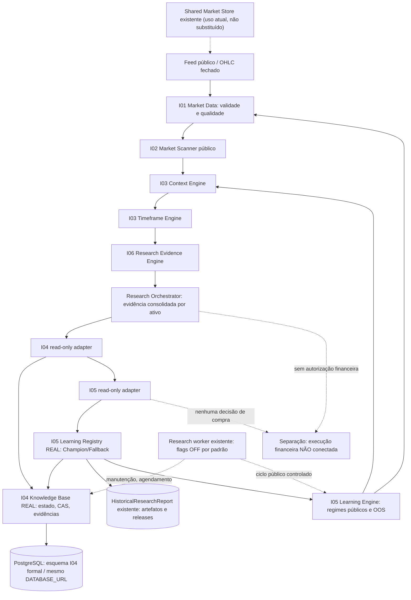

# NEXORA INTELLIGENCE 2.0 — consolidação de pesquisa (não homologada)

**Branch:** `feature/intelligence20-integrated-research-consolidation`  
**Base:** PR #62, preservando PR #59, #60, #61.  
**Fontes reais:** PR #54 e #56 para persistência e algoritmos I04/I05; PR #51–#53 já representadas por I01/I02/I03 no tronco da cadeia de pesquisa.  
**Status:** PR DRAFT, flags desabilitadas, sem merge/deploy/migração em produção.

## 1. Arquitetura integrada

Os métodos `orchestrate_public_research`,
`orchestrate_research_with_i04` e
`orchestrate_research_with_i04_i05` já existiam na cadeia #60–#62.
Esta PR **não cria outro scanner**, outro mecanismo de inferência,
segundo cache de mercado ou executor financeiro. A integração agora
inclui os módulos reais I04/I05 em lugar de depender somente de doubles
nos testes.

## 2. Contratos executáveis

| Fonte | Interface real | Função e proveniência |
|---|---|---|
| I01 | `market_data.read_closed_window` | OHLC público fechado e qualidade |
| I02 | `scan_intelligence_markets` | Seleção de mercado, estratégia/metadados públicos |
| I03 | `scan_intelligence_context` / `timeframe_engine.enrich_i02_report` | Regime e timeframes, sem execução |
| I06 | `research_signal_engine.assess_research_report` | Integridade, conflitos, fingerprint, validade, completude, WAIT/DO NOT TRADE |
| Orquestrador | `orchestrate_public_research` | Consolidação de relatório público uma vez por chamada |
| I04 | `retrieve_active` / `get_knowledge` / `review_due_knowledge` | Fonte única de conhecimento, estado e evidência |
| I04 adapter | `orchestrate_research_with_i04` | Rastreabilidade de conhecimento por ativo/regime/timeframe |
| I05 | `evaluate_public_regimes` / `get_research_release` / `run_scheduled_cycle` | Modelos públicos de regimes, OOS, release e ciclo controlado |
| I05 adapter | `orchestrate_research_with_i04_i05` | Proveniência validada de Champion/Fallback sem promover |
| Persistência | `db.SessionLocal`, `db.KnowledgeMetadata`, `HistoricalResearchReport` | Mesma conexão e tabelas I04 + tabela de relatórios existente |

`KnowledgeMetadata` é **somente** um registro declarativo SQLAlchemy
separado, não outra Knowledge Base nem outro banco. Preserva os nomes
e restrições das três tabelas I04 originais, mas impede a criação
automática dessas tabelas por `db.init_db()` da aplicação. O código
da migração formal `migrations/I04_KNOWLEDGE_BASE_V1_POSTGRES.sql`
foi preservado **sem ser executado**.

## 3. Ordem efetiva dos dados e decisões

1. Candles públicos encerrados e verificáveis são obtidos por I01.
2. I02 fornece metadados públicos, seleção e qualidade; I03
   deriva contexto e alinhamento de timeframes.
3. I06 gera evidência descritiva e motivo: sem autorizar
   CALL/PUT, instante de compra, expiração contratual ou ordem.
4. O orquestrador produz `RESEARCH_READY`, `WAIT_RECHECK` ou
   `EXCLUDED` com hash, validade, origem e justificativas.
5. O adaptador I04 somente consulta `ACTIVE` válido, revalida
   história e prazos, e identifica conflitos; **não promove**
   pesquisas com base na I04.
6. O adaptador I05 lê o release de pesquisa existente e verifica
   modelo, três janelas OOS independentes e vigência; não treina,
   promove nem faz rollback em uma avaliação de rotina.
7. O ciclo I05 **já implementado na PR #56** pode treinar pesquisa
   de regimes públicos no mesmo research worker, apenas se flags
   I04 e I05 estiverem habilitadas após homologação. Promoção de
   Champion permanece manual/explicitamente autorizada e não
   decorre do scheduler nem da consulta do orquestrador.

**Nenhum desses estados é um sinal financeiro distribuível.**
A distribuição permanece `publish_allowed=false` e a autorização
de execução permanece `execution_allowed=false`.

## 4. Persistência, reinicialização e idempotência

- I04: modelos `IntelligenceKnowledge`, `IntelligenceKnowledgeEvidence`
  e `IntelligenceKnowledgeDecision` da PR #54; mesma sessão de banco,
  sem user_id/account_id; revisão CAS e identidade pública estável.
- I05: modelo `MODEL` usa I04; artefatos `I05_ART_`, releases
  encadeados `I05_REL_` e eventos `I05_EVT_` usam
  `HistoricalResearchReport` já existente, sem tabela duplicada.
- Retenção: os prefixos I05 agora não são apagados pelo
  `cleanup_research_reports` de snapshots descartáveis.
- Reabertura de sessão e recuperação de I04/artefatos são
  verificáveis em bancos de teste descartáveis.
- O worker I04/I05 reutiliza `research_persistence.research_loop`
  existente e escreve somente quando suas flags próprias forem
  habilitadas. Por padrão, está OFF.
- Sincronização multiprocesso, idempotência cross-worker do
  orquestrador e consistência de cache **não comprovadas**;
  não há substituto fictício de Redis ou fila distribuída.

## 5. Segurança, isolamento e modos do robô

Esta branch não altera `app/real_broker.py`, rotas de compra,
permissões REAL, stake, ciclo, DEMO/REAL nem a implementação atual
dos três modos do robô.

A pesquisa utiliza apenas dados públicos e metadados I04/I05.
Nenhuma conta, saldo, stake, resultado individual, estratégia financeira
ou credencial integra o treino compartilhado. Dados DEMO/REAL/
simulação não são incorporados aos modelos de regimes públicos.

**A conexão de produção do orquestrador ao executor financeiro NÃO
existe nesta entrega e não foi acrescentada.** Preservar P0/F01
inclui NÃO importar mudanças financeiras históricas das branches
#51–#56. As variantes de P0/F01 precisam de homologação de
compatibilidade separada antes de qualquer merge amplo.

## 6. Evidência de testes, identificando mocks corretamente

- `tests/test_intelligence20_consolidated_real_persistence.py`
  instancia os módulos reais I04 e I05, roda SQLAlchemy contra
  um banco DESCARTÁVEL, cria conhecimento e evidência reais,
  recupera após nova sessão, verifica I04 adapter com registros
  persistidos, rejeita dados expirados, executa avaliação pública
  de regimes e estágios I05 Challenger **sem promoção**, e verifica
  a retenção de release.
- CI SQLite: execução isolada do teste acima e regressão completa.
- CI PostgreSQL 16 descartável: mesmo teste com as tabelas I04
  criadas explicitamente no **banco descartável de teste**.
  Não usa o PostgreSQL de produção, Deriv, Supabase ou segredos
  financeiros.
- Os testes preexistentes das PRs #59–#62 exercitam várias
  combinações com **mocks/doubles**. Continuam classificados
  como testes unitários/de contrato; não são confundidos
  com recuperação real em banco.
- **Não** foi aplicada a migração formal I04 no PostgreSQL
  descartável via SQL completo: o teste usa DDL explicitamente
  a partir do mesmo modelo ORM, sem provar a sequência de
  migração F01→I04 de produção.
- **Não** foi realizado ensaio de 500 usuários, teste de carga
  progressivo, failover multiprocesso, testes completos de REAL
  P0/F01, nem avaliação comercial dos três modos.

## 7. Infraestrutura e lacunas reais

| Componente | Situação nesta branch |
|---|---|
| I01–I03, I06, Orquestrador | Código existente preservado e encadeado |
| I04 | Código real e modelos persistentes importados; schema formal em produção **pendente** |
| I05 | Learning Engine, Registry e Cycle reais importados; promoção protegida, produção OFF |
| I04/I05 adapters | Existentes #61/#62; agora módulos reais importáveis quando habilitados |
| Market Data Store | `shared_market_store.py` já existe; sem duplicação; cache distribuído não homologado |
| Signal Priority/Distribution | **Não implementados** como distribuição de sinais financeiros nesta branch |
| Strategy Intelligence | Pesquisa pública de regimes disponível; estratégia decisória financeira fora do escopo |
| Hybrid capacity / 500 usuários | **Não comprovado** por carga; nenhum limite fictício anunciado |
| PostgreSQL | Escrita/leitura de teste com modelos I04 reais; migração formal não executada |
| Worker/observabilidade | Research loop existente, logs de estados; métricas/cotas/fila multiworker ainda pendentes |
| P0/F01 / REAL | Código de execução não modificado; homologação e release REAL continuam bloqueados |

## 8. Gates para futura homologação

1. Revisar a divergência entre os históricos antigos das PRs
   #51–#56 e a `main`, sem importação em bloco da infraestrutura
   financeira P0/F01. Resolver somente conflitos concretos.
2. Ensaiar backup e migração formal I04 em PostgreSQL descartável
   com a pré-condição F01, verificar zero DDL em execução normal.
3. Exercitar promoção/ciclo e recuperação de Champion/Fallback
   no registro real em teste com políticas separadas de aprovação.
4. Construir medições de latência, cache compartilhado, contenção
   e limites de feed sob testes de carga progressivos.
5. Validar as proteções DEMO/REAL e P0/F01 com suites específicas,
   sem executar ordens reais.
6. Somente após homologação, decidir ativação de pesquisa e
   publicar documentação operacional própria; sem ligar pesquisa
   a compras automáticas.

## 9. Política de entrega

DRAFT, branch isolada, **sem merge, deploy ou migração aplicada**.
Flags de Intelligence e REAL permanecem OFF.
Não declarar homologação ou suporte a 500 usuários sem evidências
experimentais correspondentes.
